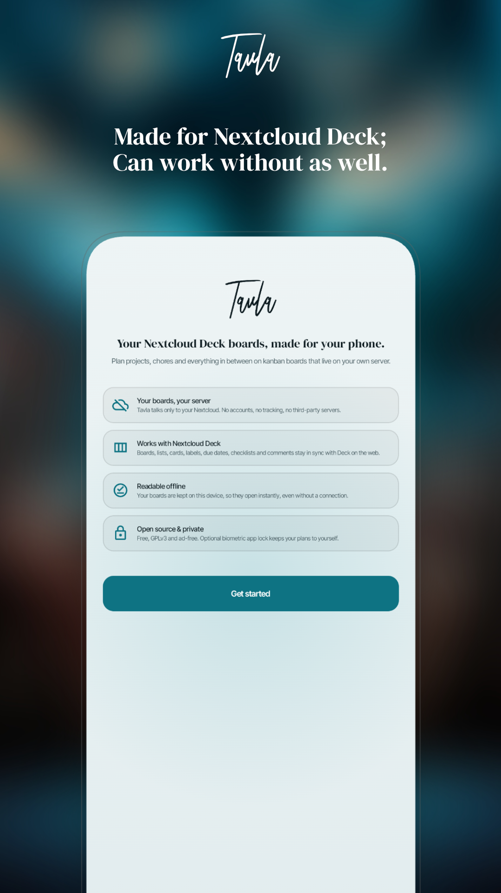
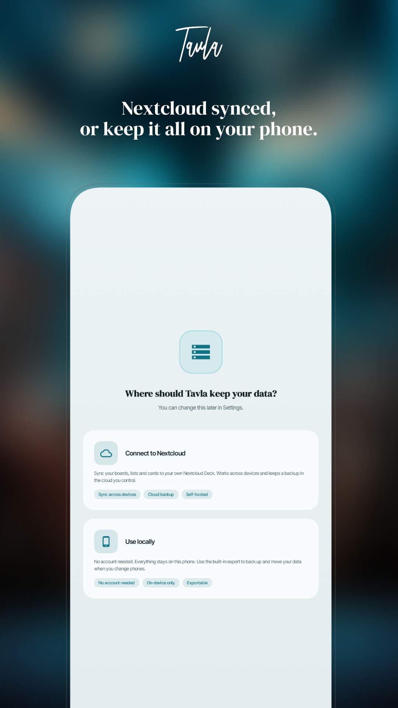
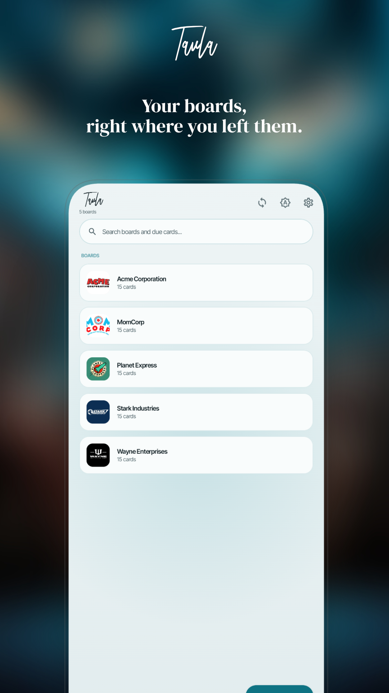
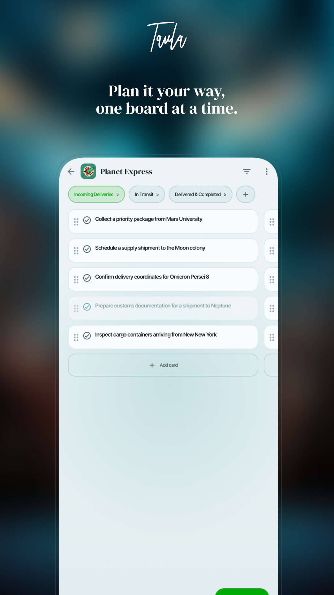
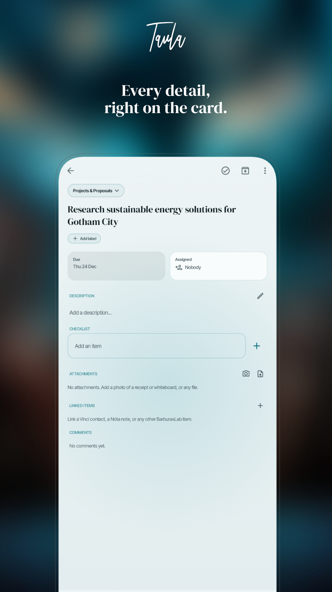
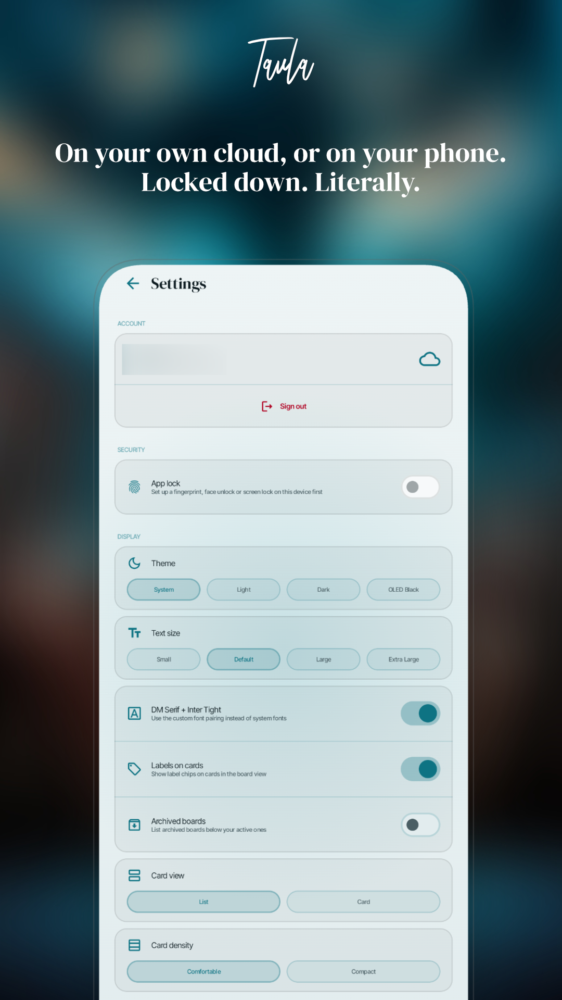

# Tavla

A free, open-source Android client for [Nextcloud Deck](https://apps.nextcloud.com/apps/deck). Part of the BarburasLab suite of privacy-first apps for the self-hosted community.

Tavla is Swedish for "board". It puts your Deck boards on your phone with the same dark glass design as the rest of the suite, and keeps an offline copy so your boards open instantly, even without a connection.


[](https://play.google.com/store/apps/details?id=com.brbrs.tavla)
[](https://android.barburas.com/repo)
[](LICENSE)


---

## Screenshots

| Onboarding | Mode picker | Boards |
|---|---|---|
|  |  |  |

| Board | Card detail | Settings |
|---|---|---|
|  |  |  |

---

## Features

- Sign in with Nextcloud Login Flow v2 (no passwords stored, only an app password)
- All your boards at a glance, with a "Due soon" strip across every board, and a Material icon or a cover photo per board (covers sync through your own Nextcloud)
- Swipe between lists, filter cards (including a Done filter), and reorder or move cards by dragging
- Full card editing: title, description (Markdown), labels, assignees, due date, done status, attachments, archive
- Checklists that stay in sync with Deck's Markdown task items
- Comments
- Links from a card to another BarburasLab app's item (e.g. a Vinci contact)
- Solidtime time tracking: link a board (or an individual card) to a self-hosted [Solidtime](https://www.solidtime.io/) project and start/stop timers from a card, with an ongoing notification, offline start/stop, per-card entry history, and per-board options for tasks, list tags and auto-stop
- Search across every open card's title and description, not just board names and due cards
- Calendar view: month or week, across every board, with drag-and-drop rescheduling
- Board insights: cards finished per week, overdue trend, average time from creation to done, and the busiest lists -- computed on-device from what's already synced
- Offline edits with a queue: changes made without a connection are saved locally and sent to the server later via WorkManager, with retries -- this is what makes Tavla offline-first rather than just offline-readable
- Local due-date reminders -- no push server involved
- Share text or a link from any app straight into a new card
- Optional biometric app lock
- System, Light, Dark and OLED Black themes, each board's own color accenting its own screen
- Settings and board/card metadata that Deck has no field for are kept in a small file in your own Nextcloud, so they follow you to a new device

## Requirements

- Android 9 (API 28) or newer
- A Nextcloud server with the Deck app enabled

## Privacy

Tavla only talks to your own Nextcloud. No ads, no analytics, no tracking, no third-party servers. See the [privacy policy](https://barburas.com/privacy-policy/).

## Building from Source

```bash
git clone https://github.com/andreibarburas/tavla-android.git
cd tavla-android
./gradlew assembleDebug
```

Or open the project in Android Studio and run the `app` configuration. Toolchain: Kotlin 2.1.0, AGP 8.10.1, Gradle 8.11.1, compileSdk/targetSdk 36, JDK 17+.

---

## About Author

Hi, I'm [Andrei Barburas](https://barburas.com). By day, I work at the intersection of information management, intelligence gathering, and human cyber risk; designing systems that make sense of complexity and surface what usually stays unseen, drawing on a background in counter-terrorism research and the behavioral patterns behind radicalization and digital vulnerability. I also lecture in Ethics, Communication Management, and Cross-Cultural Management, and write and teach courses on psychology, culture, and critical thinking.

This corner of GitHub is the other side of that same instinct. I build a small collection of free, open-source tools for people who self-host: a suite of [Android Apps](https://github.com/stars/andreibarburas/lists/android-apps) designed around Nextcloud and selfhosters, along with [Home Assistant Apps](https://github.com/andreibarburas/hassio-apps) and a handful of [Wordpress Plugins](https://github.com/andreibarburas/lists/wordpress-plugins).

I started making these because I wanted something the existing options didn't offer; small, focused tools that fit my own self-hosted setup instead of forcing me to compromise. No ads, no tracking, GPLv3 licensed where applicable, and built to work with the tools people already run at home.

## AI Usage

I'm open about the fact that I use AI throughout development. It genuinely helps me move faster and build things I wouldn't otherwise have time for as one person. But AI doesn't replace the actual work; I still spend the evenings figuring out what something should actually do, testing it against real setups and edge cases, and tracking down the inevitable weird bugs. AI is a tool I use, not a shortcut around the thinking.

## Support

If my work saves you time, a small tip means a lot:

- ⭐ **Donate via Bunq (my bank):** [bunq.me/barburasdonations](https://bunq.me/barburasdonations?description=Donation%20from%20Github)
- 🐈‍⬛ **GitHub Sponsors:** [github.com/sponsors/andreibarburas](https://github.com/sponsors/andreibarburas)
- ☕ **Buy me a coffee:** [buymeacoffee.com/barburas](https://buymeacoffee.com/barburas)
- 🌐 **Website:** [barburas.com](https://barburas.com)
- 🐛 **Issues & feature requests:** [open an issue](../../issues)

## Links

- [Play Store](https://play.google.com/store/apps/dev?id=6842866278906089090) [](https://play.google.com/store/apps/dev?id=6842866278906089090)
- [F-Droid Self-Hosted Repo](https://android.barburas.com/repo) [](https://android.barburas.com/repo)
- [r/BarburasLab](https://reddit.com/r/barburaslab) 
- [Privacy Policy](https://barburas.com/privacy-policy/) [](LICENSE)

## Other work on Github

- [Android Apps](https://github.com/stars/andreibarburas/lists/android-apps)
- [Home Assistant Apps](https://github.com/andreibarburas/hassio-apps)
- [Wordpress Plugins](https://github.com/stars/andreibarburas/lists/wordpress-plugins)

## License

All my work is licensed under the [GNU General Public License v3.0](LICENSE).

You are free to use, study, modify, and redistribute this software, provided that any distributed modifications are also licensed under GPL v3 and the source code remains available.

---

*by [andrei BARBURAS](https://barburas.com)* 